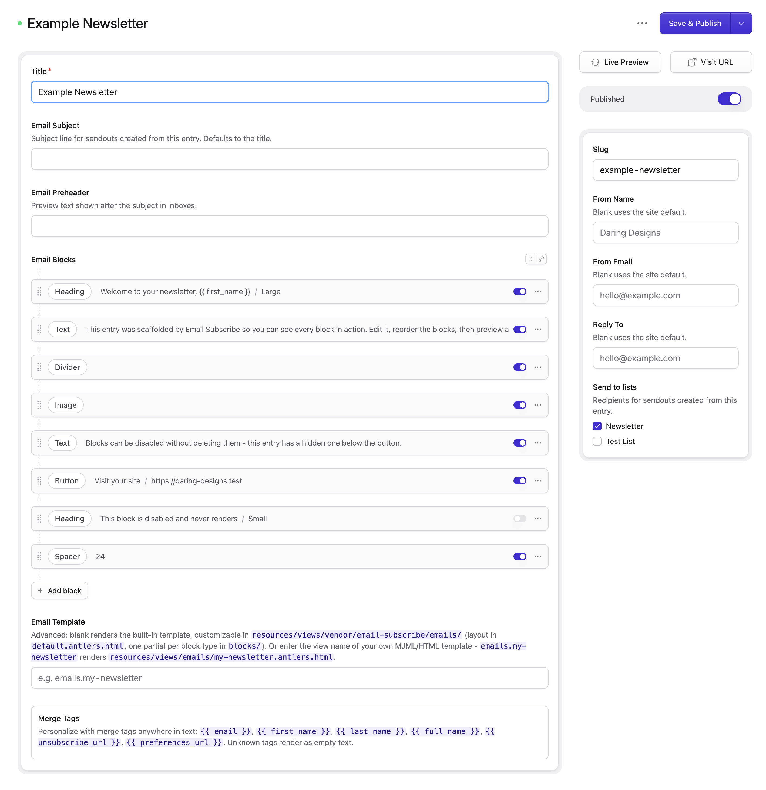
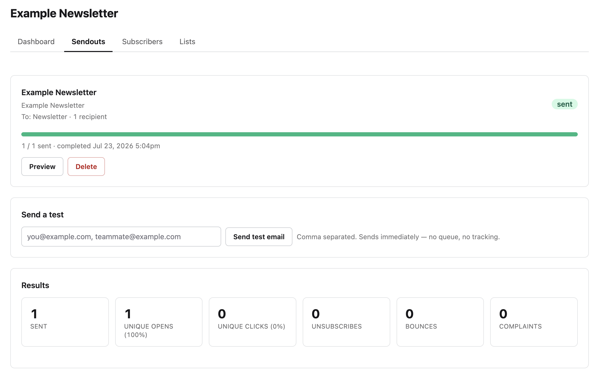
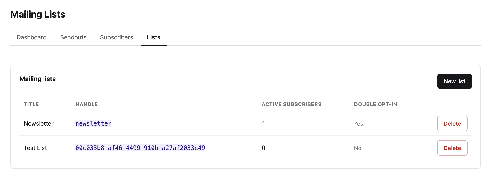

#  Postmaster

> Newsletters, natively in Statamic: build emails from blocks in the entry editor, collect subscribers with double opt-in, and deliver through your own mail provider with tracked, queue-backed sendouts.

Postmaster treats a newsletter like content, because in Statamic it is. You author an email as an entry — stacking heading, text, image, and button blocks with Live Preview of the compiled email — pick recipient lists in the sidebar, and hit Publish when it's approved to send. A sendout record tracks the delivery run: opens, clicks, bounces, complaints, and top links.

Supports **Statamic 5 and 6** with a single codebase.



## Features

- 🧱 **Email Blocks builder** — author emails as entries with a replicator of blocks (heading, rich text, image, button, divider, spacer); drag to reorder, toggle blocks off without deleting
- 👀 **Live Preview** — see the compiled, email-client-safe HTML re-render beside the entry as you type
- 🏷️ **Merge tags** — `{{ first_name }}`, `{{ email }}`, and any custom subscriber field, typed anywhere in content or subject lines; the editor lists what's available
- 🤖 **Sendouts create themselves** — saving a newsletter entry creates its draft sendout; publishing marks it ready to send, and a completed send unpublishes the entry again
- 💌 **MJML under the hood** — one template imports a partial per block type; override any single block, add your own block types, or point an entry at a fully custom template
- ✅ **Double opt-in** — signed, expiring verification links; pending subscribers never get sendouts
- 🧬 **Custom subscriber fields** — add fields to the subscriber blueprint and they're captured from signup forms and CSV imports, edited on the native entry form, and usable as merge tags
- 🚀 **Queued sendouts** — batched on your queue; pause, resume, schedule, or cancel with no double-sending
- ⚡ **Test sends** — comma-separated addresses, straight from the entry, instantly and untracked
- 📈 **Tracking & reports** — unique opens, clicks, unsubscribes, bounces, complaints, and top links per sendout
- 🔗 **Signed URLs everywhere** — unsubscribe, preferences, and tracking links are HMAC-signed
- 📥 **One-click unsubscribe** — RFC 8058 `List-Unsubscribe` headers (required by Gmail & Yahoo for bulk senders)
- 🪝 **Bounce & complaint webhooks** — Amazon SES, Mailgun, Postmark, SendGrid
- 🧑‍🤝‍🧑 **Preference center**, 📄 **CSV import/export with a downloadable template**, 🛡️ **honeypot** spam protection, 🔐 **CP permissions**
- 🤖 **AI-ready** — ships a Claude Code skill so your AI assistant knows how to draft, personalize, and send newsletters through the addon

## How to install

```bash
composer require darinlarimore/statamic-postmaster
php artisan migrate
```

Subscribers and mailing lists live as flat-file content by default (git-friendly; switch to the database driver via `POSTMASTER_STORAGE=database` for high-volume lists). Sendouts and tracking events always live in the database.

To compile MJML locally, install the node package:

```bash
npm install mjml
```

No Node in production? `POSTMASTER_MJML=api` with [MJML API](https://mjml.io/api) credentials, or `POSTMASTER_MJML=none` for plain HTML templates. MJML compiles **once per sendout**, not per recipient.

Optionally publish the config:

```bash
php artisan vendor:publish --tag=postmaster-config
```

## Quick start

```bash
php artisan postmaster:scaffold-newsletter
```

One command sets up everything: a `newsletters` collection wired with the Email Blocks fieldset, Live Preview pointed at the email renderer, an example entry showcasing every block and a merge tag, a first mailing list (if you have none), and the email templates published for customizing. It's idempotent and the collections are excluded from sitemaps/SEO automatically. Then:

1. Open the **Example Newsletter** entry and hit **Live Preview** — edit blocks and watch the email re-render.
2. Send yourself a copy via the entry's **Send Test Email** action (comma-separated addresses).
3. Pick lists in the sidebar and toggle **Published** — the entry's sendout flips to **ready to send**.
4. Open it under **Postmaster → Sendouts** and **Send now** or **Schedule**.

## The workflow

The entry is the whole authoring surface. In the main column: title, **Email Subject** (blank falls back to the title), **Email Preheader**, the **Email Blocks**, and an advanced **Email Template** override. In the sidebar: **From Name / From Email / Reply To** (placeholders show your site's configured defaults; blank uses them), **Send to lists**, and the **Published** toggle — the approval gate. Tests and Live Preview work on unpublished drafts, but a sendout can't start until the entry is published.

**Sendouts create themselves.** Saving a newsletter entry ensures a draft sendout exists for it — one active sendout per entry. Drafts follow the entry live (subject, sender, lists, everything) and freeze when the run starts. The full lifecycle:

- **ready to send** (green) — draft whose entry is published; start or schedule it from the sendout page, which also shows the recipient lists and a live recipient count.
- **scheduled** — pending with a future send time (fired by the scheduler).
- **sending / paused** — batches in flight; pause and resume freely, recipients can never be double-sent.
- **sent** — the run keeps its stats forever, and **the entry is automatically unpublished** — Published always means "approved for a send that hasn't happened yet". Editing and re-publishing the entry creates a fresh draft: that's how re-sends work.
- **Cancelling** before anything was delivered reverts the sendout to a clean ready-to-send draft; cancelling mid-send keeps the partial run's stats as a cancelled record.

The **Sendouts** screen lists every run with status and progress, offers a **New entry** button for each newsletter collection, and surfaces any entries that don't have a sendout yet.



### Using your own collection

The block set ships as a namespaced fieldset. Import it into any collection blueprint (via the blueprint builder, or in YAML):

```yaml
-
  import: postmaster::email_blocks
```

Don't use a `prefix` on the import — the fixed field handles drive the automation. The sidebar fields (sender, lists) and the merge-tag hint are injected at runtime for any blueprint carrying the blocks.

Statamic only shows the Live Preview button for routable collections. The scaffold command handles this by using the addon's (permission-gated) preview URL as the collection route — do the same for a hand-made collection:

```yaml
route: '/postmaster/entry-preview/{id}'
preview_targets:
  -
    label: Email
    url: '/postmaster/entry-preview/{id}'
    refresh: true
```

## Merge tags

Type merge tags anywhere in block text or the subject line:

```
Hi {{ first_name }}, thanks for reading!
```

Core tags: `{{ email }}`, `{{ first_name }}`, `{{ last_name }}`, `{{ full_name }}`, `{{ unsubscribe_url }}`, `{{ preferences_url }}` — plus every custom subscriber field. The entry editor lists exactly what's available. Values are swapped per recipient at send time; unknown tags render as empty text; previews show sample values.

## Subscribers, lists & custom fields

Subscribers and lists are ordinary Statamic entries (content driver), so managing them feels native:

- **Subscribers** — the addon's Subscribers screen has search, status and list filters, CSV export, an **Add subscriber** form (add as already-consented, or send an opt-in confirmation email), and **CSV import** with a downloadable template whose columns include your custom fields. Each subscriber links to its native entry publish form, where everything is editable: names, status, custom fields, **list memberships** (checkboxes — unchecking unsubscribes), even the email address (the entry re-keys itself safely). A read-only **Activity** panel shows their recent opens, clicks, and unsubscribes. Entry titles are auto-generated from the email address.
- **Lists** — created and edited as entries too: the Lists screen's **New list** button opens one, the handle defaults from the slug, and each list shows its active-subscriber count with a link to the filtered subscriber listing.



**The subscriber blueprint is the schema for custom fields.** Add a field (say `company`) to it and everything follows:

- **Captured** from subscribe forms (`<input name="company">`) and CSV import columns — anything not matching a field is ignored
- **Edited** on the subscriber's entry with the real fieldtype you chose
- **Available** as `{{ company }}` in emails and subject lines

On the database driver (no blueprint), list the handles in `postmaster.custom_fields` instead.

## Collecting subscribers

Create a list (**Postmaster → Lists**), then drop the form tag in any template:

```antlers
{{ postmaster:form list="newsletter" redirect="/thanks" class="newsletter-form" }}
    {{ if success }}
        <p>{{ success }}</p>
    {{ else }}
        <input type="email" name="email" placeholder="you@example.com" required>
        <input type="text" name="first_name" placeholder="First name">
        <button>Subscribe</button>
    {{ /if }}

    {{ postmaster:errors }}
        <p class="error">{{ error }}</p>
    {{ /postmaster:errors }}
{{ /postmaster:form }}
```

The tag renders the `<form>` wrapper for you, including the CSRF token, a spam honeypot, and a hidden field carrying the list handles — you only supply the visible inputs. Valid input names are `email` (required), `first_name`, `last_name`, and any custom subscriber field.

Use `lists="newsletter|product"` to subscribe to multiple lists at once. Add `redirect="/thanks"` to send visitors to a page instead of flashing a message.

With double opt-in enabled (the default), new subscribers get a confirmation email and stay `pending` until they click the signed verification link.

### AJAX submissions

The subscribe endpoint returns JSON when asked for it, so the same form can submit in the background without a page reload. Here is a complete starter using [Alpine](https://alpinejs.dev) that degrades to a normal POST when JavaScript is unavailable:

```antlers
<div
    x-data="{
        status: 'idle',
        message: '',
        errors: [],
        async submit(event) {
            const form = event.target;
            this.status = 'sending';
            this.errors = [];

            try {
                const response = await fetch(form.action, {
                    method: 'POST',
                    body: new FormData(form),
                    headers: { 'Accept': 'application/json', 'X-Requested-With': 'XMLHttpRequest' },
                });
                const payload = await response.json();

                if (response.ok) {
                    this.status = 'done';
                    this.message = payload.message;
                } else {
                    this.status = 'idle';
                    this.errors = Object.values(payload.errors ?? {}).flat();
                }
            } catch {
                this.status = 'idle';
                this.errors = ['Something went wrong — please try again.'];
            }
        },
    }"
    x-on:submit.prevent="submit($event)"
>
    {{ postmaster:form list="newsletter" }}
        <div x-show="status !== 'done'">
            <label for="newsletter-email" class="sr-only">Email address</label>
            <input id="newsletter-email" type="email" name="email" placeholder="you@example.com" required>
            <button type="submit" x-bind:disabled="status === 'sending'">
                <span x-text="status === 'sending' ? 'Sending…' : 'Subscribe'">Subscribe</span>
            </button>

            <ul x-show="errors.length" x-cloak role="alert">
                <template x-for="error in errors">
                    <li x-text="error"></li>
                </template>
            </ul>
        </div>

        <p x-show="status === 'done'" x-text="message" x-cloak role="status"></p>

        {{ if success }}
            <p role="status">{{ success }}</p>
        {{ /if }}
        {{ postmaster:errors }}
            <p class="error">{{ error }}</p>
        {{ /postmaster:errors }}
    {{ /postmaster:form }}
</div>
```

On success the endpoint returns `{ success: true, pending: true|false, message: "…" }` — `pending` is `true` when double opt-in is on and the subscriber still needs to confirm. Validation failures return a standard Laravel `422` with an `errors` object. The plain `{{ if success }}` / `{{ postmaster:errors }}` blocks at the bottom handle the no-JavaScript fallback, where the form does a full POST and redirects back.

If your site uses Statamic's static caching, wrap the form in `{{ nocache }}` so the CSRF token isn't cached stale. The `x-cloak` attributes need the usual one-liner in your CSS if you don't have it already: `[x-cloak] { display: none !important; }`.

## Email templates

Every sendout renders through **one template**, published to `resources/views/vendor/postmaster/emails/`:

```
emails/
├── default.antlers.html    ← layout: head, footer, and the block loop
└── blocks/
    ├── heading.antlers.html
    ├── text.antlers.html
    ├── image.antlers.html
    ├── button.antlers.html
    ├── divider.antlers.html
    └── spacer.antlers.html
```

The layout renders the entry's blocks — one partial per type — or falls back to classic content (`{{ entry:content }}` under a subject headline) for entries without blocks:

```antlers
{{ entry:email_blocks }}
    {{ partial src="postmaster::emails.blocks.{type}" }}
{{ /entry:email_blocks }}
```

Three levels of customization:

1. **Restyle a single block** — edit its partial (e.g. `blocks/button.antlers.html`); the rest stays stock.
2. **Add your own block type** — override the `postmaster::email_blocks` fieldset (copy it to `resources/fieldsets/vendor/postmaster/email_blocks.yaml`), add a set, and drop a matching `blocks/{type}.antlers.html`. The loop picks it up with zero PHP.
3. **Replace the template entirely** — set the entry's **Email Template** field to any view name (`emails.my-newsletter` → `resources/views/emails/my-newsletter.antlers.html`, Antlers or Blade, MJML or plain HTML).

Templates receive:

| Variable | Description |
| --- | --- |
| `subject`, `preheader`, `sendout` | Sendout fields |
| `entry` | The newsletter entry (optional) |
| `email`, `first_name`, `last_name`, `full_name` | Per-subscriber personalization |
| `unsubscribe_url`, `preferences_url` | Signed per-subscriber links |

The template renders and compiles **once per sendout**; personalization is substituted per recipient at send time. Links are automatically rewritten for click tracking (disable with `postmaster.tracking.clicks`).

## Queues & scheduling

Sendouts are processed in batches on your queue — run a worker (`php artisan queue:work`). With the `sync` driver everything still works; sending just happens in-request. Already-sent recipients are excluded by query, so resuming a paused run (or a retried queue job) can never double-send. Batch size, delay, retries, and the abort threshold are configurable under `postmaster.sendout`.

Scheduled sendouts fire via the scheduler:

```php
// routes/console.php
Schedule::command('postmaster:send-scheduled')->everyMinute();
```

## Bounce & complaint webhooks

Set a signing key in `.env`:

```
POSTMASTER_WEBHOOK_KEY=some-long-random-string
```

Then point your provider's webhook at:

```
POST https://your-site.com/postmaster/webhook/{ses|mailgun|postmark|sendgrid}?key=YOUR_KEY
```

Hard bounces and spam complaints flip the subscriber to `bounced`/`complained` and permanently exclude them from sendouts. (SES SNS subscriptions are auto-confirmed on first delivery.)

## Importing

Import from the CP (**Postmaster → Subscribers**, with a downloadable CSV template) or the command line:

```bash
php artisan postmaster:import subscribers.csv --list=newsletter --subscribed
```

The CSV needs an `email` column; `first_name`/`last_name` and any custom subscriber field columns are picked up when present. Omit `--subscribed` to import as pending. Export is available from the same screen.

## AI assistant (Claude Code)

The addon ships a [Claude Code](https://claude.com/claude-code) skill teaching an AI assistant this addon's workflow — the entry-drives-everything model, the publish-to-send gate, merge tags, subscriber keying, and the actions that aren't entry writes. It's published to `.claude/skills/postmaster/` on install (non-forced, so your edits survive updates), or manually:

```bash
php artisan vendor:publish --tag=postmaster-skill
```

With it in place, an assistant can draft a campaign from your content, personalize it with merge tags, and drive the send — using Statamic's native entry tools, since that's all a newsletter is here.

## Config reference

See [config/postmaster.php](config/postmaster.php) — from name/email, mailer, storage driver, queue connection/name, batch settings, double opt-in, verification link expiry, open/click tracking toggles, MJML strategy, redirect URLs, route prefix, and custom subscriber fields.

## License

Commercial — one project per license. See [LICENSE](LICENSE).
